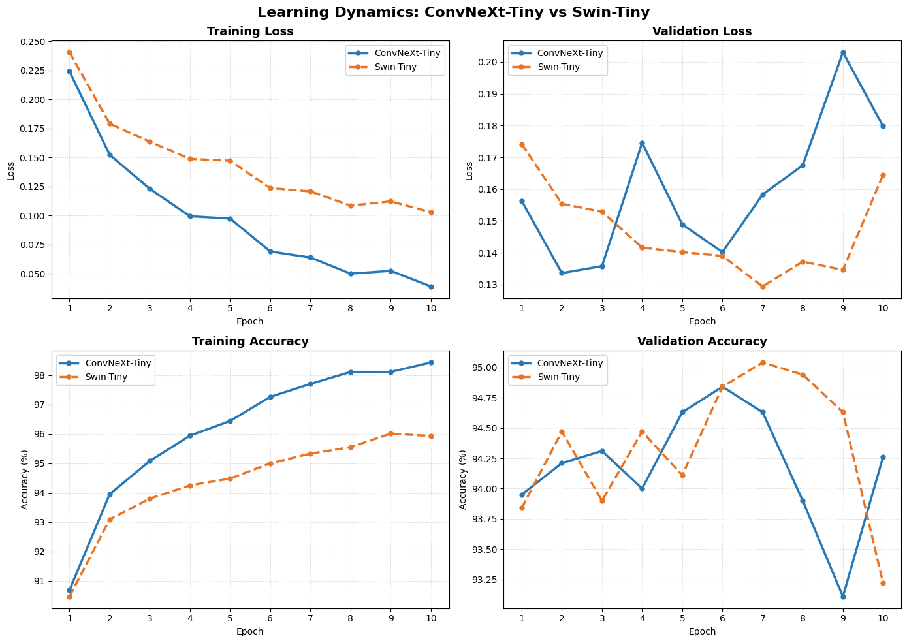
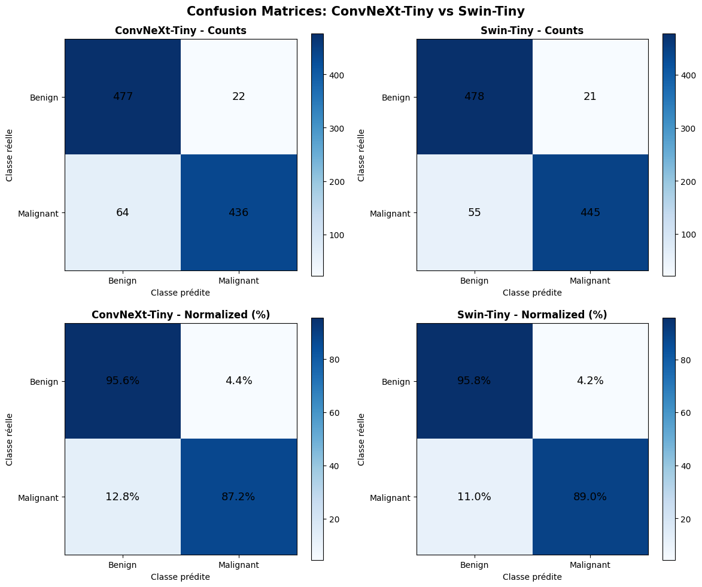
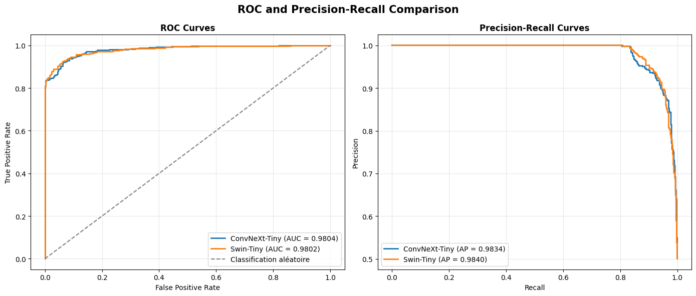
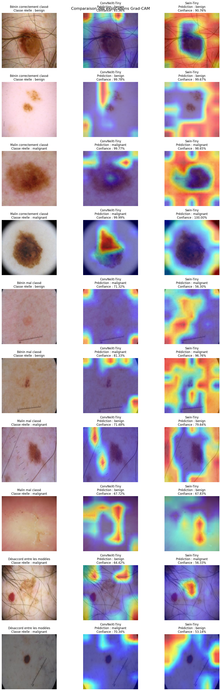
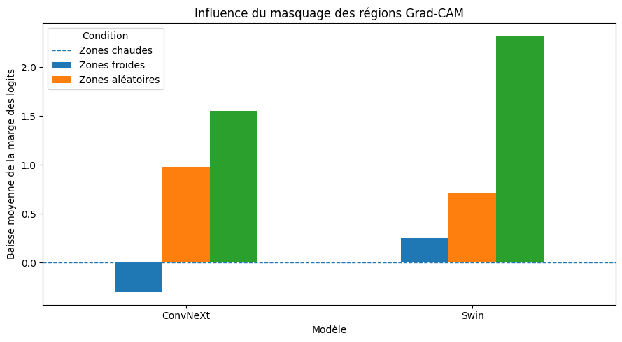

# Classification des lésions cutanées : ConvNeXt-Tiny vs Swin-Tiny

**Comparaison de modèles de Deep Learning et étude de l'explicabilité (XAI) avec Grad-CAM.**

## Présentation

Ce projet porte sur la classification binaire d'images de lésions cutanées en deux classes : **benign** et **malignant**. Deux architectures pré-entraînées sur ImageNet sont comparées : **ConvNeXt-Tiny** et **Swin-Tiny**.

Au-delà des performances, le travail étudie les erreurs des modèles et analyse les régions associées à leurs prédictions avec **Grad-CAM**. Une expérience de masquage complète cette étude pour examiner l'influence des régions mises en évidence.

> **Avertissement :** projet académique et expérimental. Ces modèles ne constituent pas des outils de diagnostic médical.

## Sommaire

- [Résultats principaux](#résultats-principaux)
- [Objectifs](#objectifs)
- [Dataset et préparation](#dataset-et-préparation)
- [Modèles et entraînement](#modèles-et-entraînement)
- [Évaluation et visualisations](#évaluation-et-visualisations)
- [Explainable AI (XAI)](#explainable-ai-xai)
- [Technologies](#technologies)
- [Organisation du dépôt](#organisation-du-dépôt)
- [Installation et exécution](#installation-et-exécution)
- [Limites et perspectives](#limites-et-perspectives)
- [Références](#références)

## Résultats principaux

Les deux modèles sont évalués sur le même jeu de test de **999 images**. La classe `malignant` est considérée comme positive.

| Métrique | ConvNeXt-Tiny | Swin-Tiny |
|:--|--:|--:|
| Accuracy | 91.39 % | **92.39 %** |
| Precision | 95.20 % | **95.49 %** |
| Recall | 87.20 % | **89.00 %** |
| Specificity | 95.59 % | **95.79 %** |
| F1-score | 91.02 % | **92.13 %** |
| ROC-AUC | **98.04 %** | 98.02 % |

Swin-Tiny obtient les meilleurs résultats sur cinq métriques sur six. ConvNeXt-Tiny présente un ROC-AUC très légèrement supérieur. Les performances des deux modèles restent proches.

## Objectifs

- Comparer ConvNeXt-Tiny et Swin-Tiny sur une tâche de classification binaire.
- Évaluer les modèles à l'aide de métriques complémentaires.
- Étudier les erreurs communes et les désaccords entre les modèles.
- Analyser les prédictions avec Grad-CAM et une expérience de masquage.

## Dataset et préparation

Le jeu de données utilisé est le [Melanoma Skin Cancer Dataset of 10000 Images](https://www.kaggle.com/datasets/hasnainjaved/melanoma-skin-cancer-dataset-of-10000-images) disponible sur Kaggle.

Après vérification des images et suppression de **22 images dupliquées** détectées par empreinte SHA-256, le dataset final contient **10 583 images**. Le jeu de test d'origine a été conservé ; la validation a été créée à partir des données d'entraînement (`test_size=0.20`, `random_state=42`, stratification par classe).

| Ensemble | Benign | Malignant | Total |
|:--|--:|--:|--:|
| Entraînement | 3 992 | 3 675 | 7 667 |
| Validation | 998 | 919 | 1 917 |
| Test | 499 | 500 | 999 |
| **Total** | **5 489** | **5 094** | **10 583** |

## Modèles et entraînement

Les deux architectures utilisent des poids pré-entraînés sur ImageNet, avec une tête de classification adaptée à deux classes.

| Paramètre | Configuration |
|:--|:--|
| Taille d'entrée | 224 × 224 |
| Batch size | 32 |
| Époques | 10 |
| Optimiseur | AdamW |
| Learning rate | `1e-4` |
| Weight decay | `1e-4` |
| Fonction de perte | CrossEntropyLoss |
| Sélection du modèle | Plus faible perte de validation |

Les transformations d'entraînement comprennent un recadrage aléatoire, un retournement horizontal et une rotation. La validation et le test utilisent uniquement le redimensionnement et la normalisation ImageNet.

## Évaluation et visualisations

Les matrices de confusion montrent **86 erreurs** pour ConvNeXt-Tiny (22 faux positifs et 64 faux négatifs) et **76 erreurs** pour Swin-Tiny (21 faux positifs et 55 faux négatifs).







Une comparaison des prédictions sur les mêmes images donne :

| Résultat comparatif | Nombre d'images |
|:--|--:|
| Les deux modèles ont raison | 900 |
| Les deux modèles se trompent | 63 |
| ConvNeXt-Tiny seul a raison | 13 |
| Swin-Tiny seul a raison | 23 |

Ces résultats permettent de distinguer les erreurs communes des erreurs propres à chaque architecture. L'analyse comprend également les courbes d'apprentissage, les courbes ROC et Precision-Recall ainsi que la calibration.

## Explainable AI (XAI)

L'objectif de cette partie est de ne pas se limiter au score de classification, mais d'examiner **où** les modèles portent leur attention et si les régions mises en évidence influencent effectivement leurs prédictions.

### 1. Comparaison Grad-CAM

Grad-CAM est appliqué aux deux architectures pour visualiser les régions associées au score de la classe ciblée. Les cartes sont comparées sur cinq situations :

- images bénignes correctement classées par les deux modèles ;
- images malignes correctement classées par les deux modèles ;
- images bénignes mal classées par les deux modèles ;
- images malignes mal classées par les deux modèles ;
- images pour lesquelles les modèles sont en désaccord.



### 2. Analyse des erreurs avec Grad-CAM

Des erreurs sélectionnées sont étudiées séparément. Pour chaque image, les cartes sont calculées en ciblant la **classe prédite** puis la **classe réelle**. Cette double visualisation aide à examiner les régions associées à la décision erronée et la réponse du modèle lorsqu'on lui demande d'expliquer la classe correcte.

### 3. Expérience de masquage

Une expérience est menée sur **94 images**, avec les deux modèles et trois stratégies de masquage. Dans chaque cas, **20 % des pixels** sont masqués :

- **Hot** : pixels ayant les valeurs Grad-CAM les plus élevées ;
- **Cold** : pixels ayant les valeurs Grad-CAM les plus faibles ;
- **Random** : pixels choisis aléatoirement, avec cinq répétitions.

L'influence du masquage est mesurée par la diminution de la marge entre le logit de la classe initialement prédite et celui de l'autre classe. Les comparaisons appariées sont évaluées avec le test de Wilcoxon.

| Modèle | Comparaison | Images où Hot entraîne une baisse supérieure | p-value |
|:--|:--|--:|--:|
| ConvNeXt-Tiny | Hot vs Random | 42.6 % | 0.068266 |
| ConvNeXt-Tiny | Hot vs Cold | 87.2 % | 4.063 × 10⁻¹⁵ |
| Swin-Tiny | Hot vs Random | 31.9 % | 0.0001566 |
| Swin-Tiny | Hot vs Cold | 58.5 % | 0.019097 |



**Interprétation.** Hot entraîne plus souvent une baisse de marge que Cold pour les deux modèles. La comparaison avec Random est plus nuancée : pour ConvNeXt-Tiny, la différence n'est pas statistiquement significative au seuil de 5 %. Pour Swin-Tiny, la différence est statistiquement significative, mais Hot entraîne une baisse supérieure à Random dans seulement 31.9 % des images. Ainsi, les régions Grad-CAM sont liées aux prédictions, mais cette expérience ne montre pas qu'elles sont systématiquement plus importantes que des régions choisies au hasard.

## Technologies

`Python` · `PyTorch` · `Torchvision` · `NumPy` · `Pandas` · `Matplotlib` · `Scikit-learn` · `Pillow` · `SciPy` · `pytorch-grad-cam` · `Kaggle`

## Organisation du dépôt

```text
skin_cancer_classification_xai/
├── .gitignore
├── README.md
├── requirements.txt
├── notebooks/
│   ├── 01_skin_cancer_classification.ipynb
│   └── 02_skin_cancer_xai.ipynb
└── assets/
    └── figures/
        ├── classification/
        │   ├── confusion_matrices.png
        │   ├── learning_curves_comparison.png
        │   └── roc_precision_recall.png
        └── xai/
            ├── gradcam_comparison.png
            └── masking_influence.png

```

Le notebook et les poids des modèles peuvent être ajoutés dans des dossiers `notebooks/` et `models/` si leur partage est souhaité.

## Installation et exécution

Le notebook a été développé dans **Kaggle avec GPU**.

1. Ouvrir le notebook dans Kaggle.
2. Ajouter le dataset indiqué dans [Dataset et préparation](#dataset-et-préparation).
3. Activer un GPU si disponible.
4. Installer Grad-CAM si nécessaire :

   ```bash
   pip install grad-cam
   ```

5. Exécuter les cellules dans l'ordre.

Les chemins des données et des checkpoints dépendent de l'environnement Kaggle et peuvent devoir être adaptés pour une exécution locale.

## Limites et perspectives

- L'étude repose sur un seul dataset ; la généralisation à d'autres sources d'images reste à évaluer.
- Les analyses détaillées Grad-CAM et les expériences de masquage portent sur des échantillons sélectionnés.
- Grad-CAM fournit une visualisation liée au score du modèle, pas une explication causale ni une preuve de pertinence médicale.
- Les résultats du masquage dépendent de la sélection des pixels et de leur remplacement.
- Une suite possible serait d'évaluer les modèles sur des données externes et d'étudier d'autres méthodes XAI.

## Références

- [Dataset – Melanoma Skin Cancer Dataset of 10000 Images (Kaggle)](https://www.kaggle.com/datasets/hasnainjaved/melanoma-skin-cancer-dataset-of-10000-images)
- [ConvNeXt: A ConvNet for the 2020s](https://arxiv.org/abs/2201.03545)
- [Swin Transformer: Hierarchical Vision Transformer using Shifted Windows](https://arxiv.org/abs/2103.14030)
- [Grad-CAM: Visual Explanations from Deep Networks via Gradient-based Localization](https://arxiv.org/abs/1610.02391)
- [pytorch-grad-cam](https://github.com/jacobgil/pytorch-grad-cam)

---

*Projet académique de classification d'images et d'analyse de l'explicabilité des modèles de Deep Learning.*
